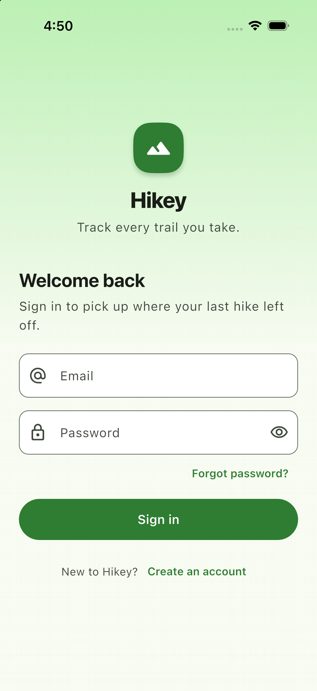
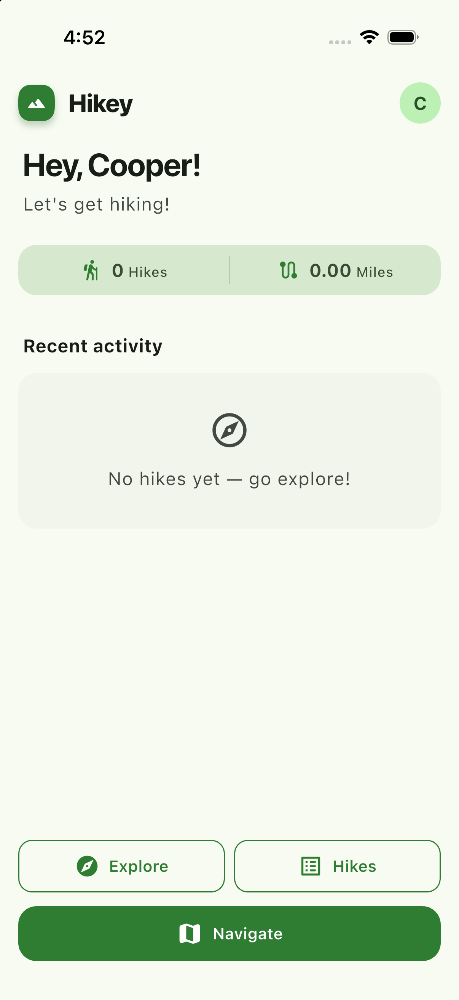

# Hikey

Hikey is a mobile app for hiking enthusiasts, built with Flutter.

> **Note:** Hikey is a work in progress. The current design is an early concept and will evolve as development continues.

**Stack:** Dart, Flutter, Mapbox API

**Backend:** [Hikey API](https://github.com/coopjc/hikey)

## Screenshots

### Sign In

### Home

### Map (Idle)

