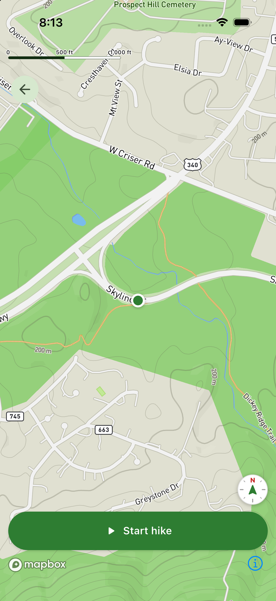

# Hikey

Hikey is a mobile app for hiking enthusiasts, built with Flutter.

> **Note:** Hikey is a work in progress. The current design is an early concept and will evolve as development continues.

**Stack:** Dart, Flutter, Mapbox API

**Backend:** [Hikey API](https://github.com/coopjc/hikey)

## Screenshots

<table>
  <tr>
    <th align="center">Sign In</th>
    <th align="center">Home</th>
    <th align="center">Map (Idle)</th>
  </tr>
  <tr>
    <td></td>
    <td></td>
    <td></td>
  </tr>
</table>
